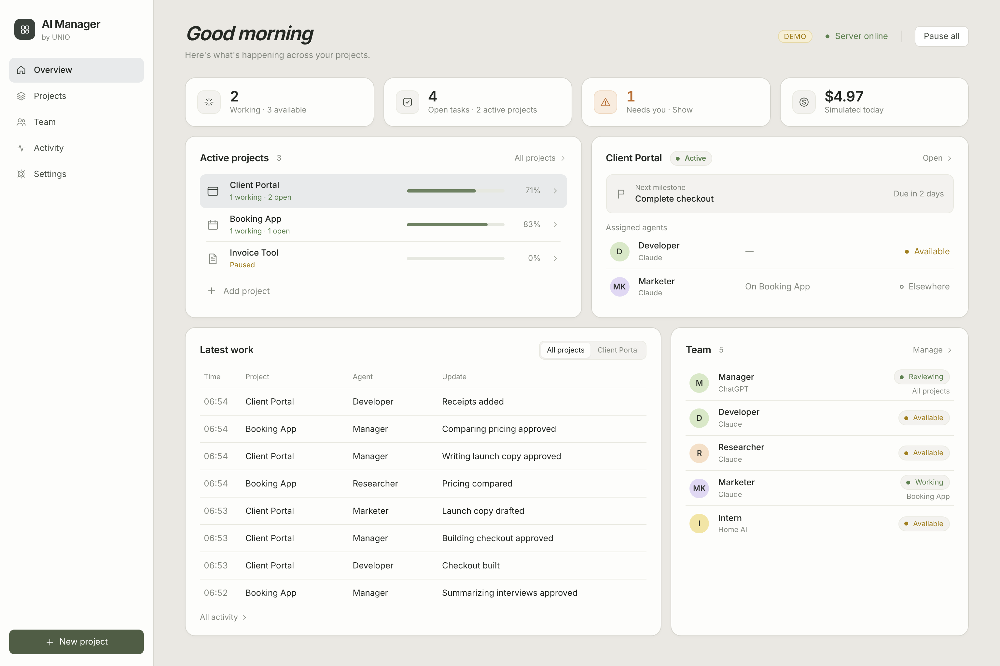

# AI Manager

A self-hosted dashboard and execution runner for a small AI team working across several projects. One owner, one Ubuntu server, Docker Compose.



## What you get

- **Overview** (Folio-style calm overview): a greeting with server connection and Pause all; stat cards for working agents, open tasks, what needs you (expands in place) and today's spend; an **Active projects** list with task-completion bars that picks the selected project; the selected project's next milestone and assigned agents; a **Latest work** table across all projects; and the global Team panel. Navigation is a left sidebar on desktop and a floating bottom bar on phones.
- **Projects**: create/edit, brief and goals, roadmap milestones (validation → development → storefront → marketing → sales → onboarding), tasks with dependencies and acceptance criteria, agent assignments, outputs, spending, pause/resume/archive.
- **Team**: agent configuration (role, provider, model, capacity, capabilities, tools, instructions), status, current assignment, run history, run logs (observable actions only), outputs, errors, usage and cost, pause/resume.
- **Activity**: searchable cross-project events with project, agent, type and date filters, linked to runs, tasks and deliverables.
- **Settings**: provider connection status, default models, concurrency, spending caps, permissions, staleness thresholds, authentication, export, and the Intern evaluation table.
- **Runner**: task queue, fair scheduler, worker slots, Manager review with bounded rework, retries, budgets, pause/cancel, crash recovery and duplicate-execution protection.

## Architecture

```
browser ──HTTPS──> [web]  Node http server: dashboard, JSON API, SSE (/api/stream), login
                     │
                     └── SQLite (WAL) /data/app.db ── project files /data/projects/<id>/
                     │
                   [runner] scheduler + worker slots ──> adapters: openai | anthropic | local | simulated
```

- Node.js 22, plain ES modules, **no npm dependencies**. SQLite through the built-in `node:sqlite`.
- Two processes from one image: `web` (`src/server.js`) and `runner` (`src/runner.js`). They share only the database and the data folder. The runner writes events and a heartbeat; the web process streams them to the browser.
- All scheduling, permissions, budgets, retries, staleness and state transitions are ordinary code (`src/runner.js`, `src/store.js`). Models are only called inside adapters (`src/workers/`).

### Data model (separate concepts)

| Concept | Table | Notes |
|---|---|---|
| Agent identity | `agents` | A specific worker with its own config and history. Same-role agents get distinct names ("Developer 2"). |
| Role | `agents.role` | Manager, Developer, Researcher, Marketer, Intern, or any new role. Exactly one Manager. |
| Provider/model | `agents.provider`, `agents.model` | `openai`, `anthropic`, `local`, or `simulated`. Model ids are configurable. |
| Run | `runs` | One execution or review of a task, with lease, idempotency key, provider state, log and verdict. |
| Project scoping | `project_id` on tasks, runs, artifacts, usage, events | Dependencies can't cross projects, and run context only includes the task's own project. |

Task states: queued → running → awaiting review → completed, with blocked, failed and cancelled. Task state is separate from agent status (working, reviewing, available, queued, blocked, failed, paused, offline, unknown), and agent status is derived from runs plus telemetry freshness at read time.

### Live status is honest

The app tracks runner heartbeat, the last activity of each run, run start time, provider request state, and the dashboard's own stream connection separately. If a run's activity or the runner's heartbeat goes stale, the agent shows **Unknown** (with its last known activity), never an indefinite green Working. There are no progress percentages or ETAs.

### Scheduling

- Global concurrency, per-project concurrency, and per-agent capacity are all enforced; an agent never runs more tasks than its capacity.
- Projects share capacity by stride scheduling weighted by project priority, so a busy project can't starve another.
- Paid runs reserve their per-run cap before starting; a run only starts if spend today/this month plus all in-flight reservations stays under the global and project caps. A request already in flight can finish slightly above its estimate.
- Manager review: approve → completed; rework → back to the queue with notes, at most `max_review_rounds` times, then blocked with a summary; block → waits for you.
- Failures retry up to `max_attempts`, then the task fails and shows as needing you. Intern work that can't be done locally is reassigned once to a Claude worker if permitted.

### Recovery and duplicate protection

- Claiming a task is an atomic state change plus a run row with a unique idempotency key; two runners racing on the same task can't both start it.
- Runs hold a 60-second lease renewed every tick. When a runner dies, its runs are recovered after its heartbeat goes stale: internal work is re-queued (one attempt used); external actions whose outcome is unknown are marked `unknown` and blocked for you, never repeated.
- Everything is persisted, so refreshes and restarts lose nothing.

## Run it

### Demo on your laptop (no keys, sample data, simulated work)

```bash
npm run demo           # http://127.0.0.1:8080, data in ./data/demo.db
```

Demo mode uses its own database (`demo.db`), shows a **Demo** badge, and runs every agent through the deterministic simulator. Simulated costs are labelled as simulated, never as charges.

### Normal local run

```bash
npm run dev            # web + runner in one process, data in ./data/app.db
```

With no credentials, every agent shows **Offline · Not connected**. You can still create projects, milestones and tasks. To exercise the pipeline without paying, set an agent's provider to **Simulator** in Team.

Sign-in is disabled only when listening on loopback with no password; the web server refuses to bind to any other address without `OWNER_PASSWORD` or `OWNER_PASSWORD_HASH`.

### Production (Ubuntu)

See [docs/DEPLOY.md](docs/DEPLOY.md) (Docker Compose, Tailscale or Caddy, health checks, restart policy, logs) and [docs/BACKUP.md](docs/BACKUP.md) (backup, restore, moving servers). Configuration template: [.env.example](.env.example).

```bash
cp .env.example .env && chmod 600 .env    # fill in OWNER_PASSWORD_HASH and SESSION_SECRET
docker compose up -d --build
```

### Tests

```bash
npm test
```

## Providers and costs

Read [docs/PROVIDERS.md](docs/PROVIDERS.md) before turning on paid execution. In short: the Manager uses the OpenAI Responses API, workers use the Claude Messages API, and both are billed per token to API accounts that are separate from ChatGPT/Claude subscriptions. The home AI is reached through an OpenAI-compatible endpoint; its compute is labelled "not priced", not free. Paid calls are blocked unless `PAID_EXECUTION_ENABLED=1` and a key is set.

## What is real, simulated, and unfinished

**Real and tested offline**
- Persistence, multi-project data model, all five pages, live updates over SSE, login, CSRF protection, secret redaction.
- Scheduler, concurrency, fair share, dependencies, review/rework limits, retries, pause/cancel, budgets with reservations, crash recovery, duplicate protection, Intern fallback.
- Provider adapters for OpenAI, Anthropic and a local OpenAI-compatible endpoint, written against the official docs (checked 2026-11-03) and tested with mocked HTTP.

**Simulated**
- The simulator worker (`provider: simulated`, and every agent in demo mode). Its outputs are placeholders that say so.

**Not done yet**
- No real provider call has been made. Phase 3 is to verify one bounded internal assignment end to end (Manager → Claude worker → saved deliverable → Manager review → completion) once keys, `PAID_EXECUTION_ENABLED=1` and caps are set.
- The Manager doesn't yet *propose* tasks from a project goal; you create tasks, and the Manager reviews results. Planning calls come after the Phase 3 check.
- Intern evaluation is a manual record (samples, pass rate, speed, review time, decision). Running sample batches against the home AI automatically comes with Phase 3.
- External actions (outreach, publishing) are modelled and protected but not executed. Marketing and sales stay draft-only.
- Docker images were not built in this sandbox (no Docker daemon). The compose file and scripts were checked against the app's commands, env vars and health checks.

## Layout

```
src/server.js      web: API, SSE, auth, static files
src/runner.js      scheduler + worker slots + recovery
src/store.js       domain rules, status derivation, budgets
src/db.js          schema and settings
src/auth.js        owner login (scrypt hash or password), signed cookies
src/demo.js        demo data (demo.db only)
src/workers/       adapter interface, simulator, OpenAI, Anthropic, local, pricing
public/            dashboard (vanilla JS modules, Inter font bundled)
deploy/            Caddyfile, backup/restore scripts, systemd timer
docs/              DEPLOY, BACKUP, PROVIDERS, screenshots
test/              node:test suites
```
